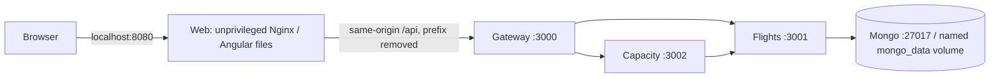
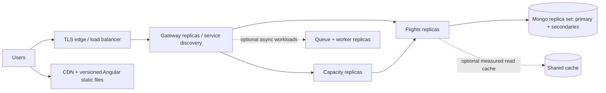

# Cargo dashboard: current design and horizontal scaling

## Implemented: local full-stack Compose

`docker compose up -d --build` starts all five services. Web is a production Angular build served on port 8080, not `ng serve`. All published host ports remain loopback-only. Host Angular hot reload is still available separately on 4200 with its existing dev proxy. The UI uses relative `/api` URLs in either mode; no per-environment hostname is compiled into it.

The frontend build uses Node 22.19.0 and npm 11.6.2 from the existing engine contract, `npm ci`, then Angular's production output at `dist/web/browser`. Only compiled static files enter the unprivileged Nginx runtime. Docker build inputs are allowlisted; environment files and npm authentication configuration are not copied. Dependencies have not been upgraded. Tags pin release lines, not immutable digests; production needs patch/security review and digest management.

Nginx strips `/api/` before forwarding to gateway, preserves query strings, and never turns API errors into SPA HTML. Docker DNS refreshes the gateway address after recreation. Client-side route refresh falls back to `index.html`; nonexistent static assets return 404. HTML revalidates (`no-cache`), content-hashed Angular JS/CSS is immutable for one year, other static assets revalidate, and API responses are `no-store`. No response cache is implemented. Deploy HTML/assets consistently and retain prior hashed assets during rolling releases so old open tabs can still fetch their chunks.

Web's healthcheck checks **Nginx liveness only**. Mongo has its existing ping healthcheck; startup ordering for the Nest services is not API readiness or continuous recovery. These local services have no implemented auth, TLS edge, autoscaler, production discovery or replicated database. Do not expose this backend publicly before security hardening.

## Proposed only: proportionate production horizontal architecture

- Serve Angular through object storage/CDN where practical; static delivery and API capacity scale independently. Route the public `/api` origin to an authenticated, rate-limited TLS edge. If using a separate API origin, explicitly design CORS/cookies instead of assuming the current same-origin setup covers it.
- Keep gateway, flights and capacity stateless, with external data/session state. Run multiple replicas behind managed load balancing and service discovery. Avoid local-memory sessions, coordination locks or replica-local caches as sources of truth. Start with a small managed container service; Kubernetes is optional if operational complexity is justified, not required for a learning app.
- Add separate liveness and readiness endpoints. Admit traffic only after dependencies are usable, remove unhealthy replicas, and drain in-flight requests on shutdown before termination. Set finite end-to-end timeout budgets, concurrency limits and bounded retries with backoff/jitter. Retry only operations safe to repeat; future writes/jobs require explicit idempotency keys/deduplication, not blind retries. Discovery must track changing replicas, not fixed IPs.
- Mongo replica sets primarily provide high availability/failover; they do **not** multiply primary write capacity. Secondary reads have consistency/lag tradeoffs. Measure query plans and indexes, add pagination/projection where appropriate, and budget per-replica connection pools so total app replicas do not overwhelm Mongo. Consider sharding only when measured data/workload requires it and after choosing a suitable shard key.
- Capacity is weighted utilisation: `sum(bookedKg) / sum(capacityKg)`, not an average of percentages. Its request fetches the flights view separately from the dashboard's flight list; concurrent changes can produce different snapshots. Define an acceptable freshness/SLO before caching or precomputation. If strict agreement becomes necessary, return summary and rows from a shared version/snapshot rather than claiming independent requests are atomic. The current client filters rows without recomputing the overall summary; label/understand global vs filtered totals.
- Shared caches, queues and worker replicas are optional **future** tools, not implemented optimisations. Define cache keys, TTLs, invalidation and stale-data behavior; queue processing needs idempotency, retry bounds and dead-letter handling. Do not add them without a workload benefit.
- Instrument request rate, p50/p95/p99 latency, errors, CPU/memory/event-loop lag, in-flight work, database latency/connections/replication lag and (if introduced) queue depth/cache hit rate. Load-test realistic data and dependencies; scale from bottlenecks and SLOs, not invented throughput numbers. More gateway replicas will not fix a saturated database or an unbounded flights query.

## Why this Compose file is not an autoscaling design

Fixed published host ports (3000/3001/3002/8080) collide when scaling services on one host. This file has no `container_name`; adding fixed container names would also prevent replicas. Production needs an edge with internal-only replica ports and proper discovery/load balancing, readiness, resource limits and rollout orchestration. `docker compose --scale` alone is not that architecture. No scaling infrastructure is added here.

## Security and persistence boundaries

Mongo auth/least privilege, external secret management, TLS, service-to-service authorization, API validation/rate limits, image scanning and backup/restore drills remain production prerequisites. Never put credentials in Git, build args, image layers, URLs in logs or public docs. Existing local `mongo_data` must be preserved: keep the Compose project name and never use volume deletion or reseeding as a normal restart. Database HA does not replace backups. This document is a learning design, not a security or performance certification.
